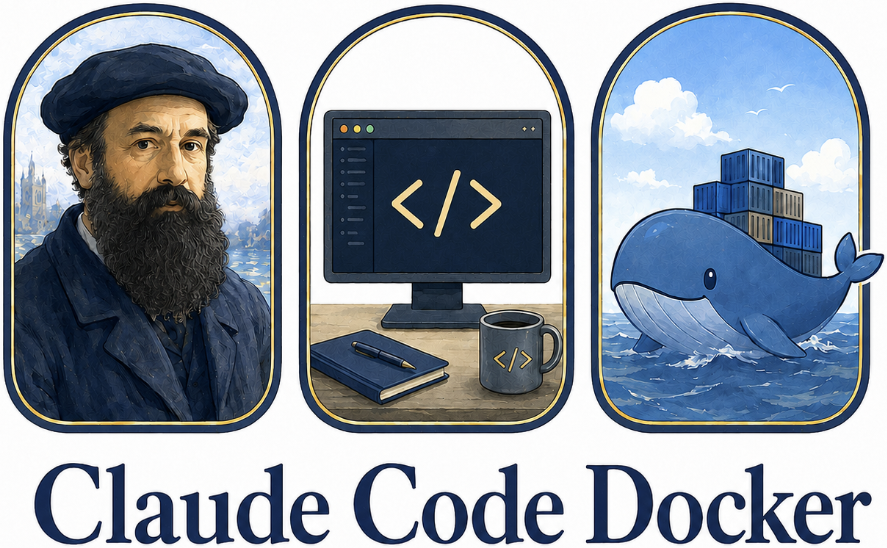

# Claude Code Docker

<p align="center">
  
</p>

**CCD** is a Python wrapper to build and run AI coding assistants inside a Docker container.

It builds a Docker image with one or more assistant CLIs and runs them against your local app folder.
Toolchains stay isolated while your project files remain local and editable.

Base image: Alpine 3.24 with Node.js, Python, and uv installed.

**Why?**

- Avoid installing assistant toolchains on your host.
- Keep a consistent, reproducible runtime across projects.
- Use separate app folders without cross-project conflicts.

## Similar Projects

- [Bubblewrap](https://github.com/containers/bubblewrap)
- [Docker Sandboxes](https://docs.docker.com/ai/sandboxes/)
- [NVIDIA OpenShell](https://github.com/NVIDIA/OpenShell)
- [claude-code-devcontainer](https://github.com/trailofbits/claude-code-devcontainer)
- [TencentCloud/CubeSandbox](https://github.com/TencentCloud/CubeSandbox)

## Quickstart

```bash
git clone git@github.com:sumkincpp/claude-code-docker.git
cd claude-code-docker
uv tool install . -e
ccd build
ccd run .
```

## Features (Build-Time)

Default build includes all clients and rust; you can include or exclude features.
Exclude `rust` with `--without rust` to keep the image smaller.

### CLI Clients

- `claude` - Anthropic Claude Code CLI
- `codex` - OpenAI Codex CLI
- `gemini` - Google Gemini CLI
- `opencode` - OpenCode CLI
- `copilot` - GitHub Copilot CLI
- `pi` - Pi Coding Agent CLI
- `jules` - Jules CLI (disabled by default)

### CLI Isolation

Each pnpm CLI tool is installed into its own directory under `~/.local/share/ccd/pnpm-installs/<name>/`.

At runtime each binary in `~/.local/bin/` is a small wrapper script pointing into its own install directory.

### Runtimes

- `rust` - Rust toolchain via rustup
- `go` - Go toolchain from go.dev

## Requirements

- Docker (or [buildah](docs/buildah.md) as the build backend)
- Python 3.12+
- uv (required for Quickstart and development)
- Host OS: Linux or macOS (Windows via WSL2).

## Backends

CCD builds the image and runs it through pluggable *backends*. Choose them in `ccd.toml`. The image is described by
[features](docs/features.md); ccd generates the Dockerfile from them.

```toml
[build]
backend = "buildah"      # who builds the image   (default: the [run] backend)

[run]
backend = "podman"       # who runs it            (default: docker)
```

`ccd build --backend X` overrides the build backend for that command, and `ccd . --backend Y` / `ccd run --backend Y` the run
backend. `ccd attach` uses the run backend.

| Backend | Builds | Runs | Needs |
|---|---|---|---|
| `docker` | yes | yes (container) | Docker |
| `podman` | yes | yes (container) | podman, rootless setup (`/etc/subuid`) |
| `gvisor-docker` | no (uses docker's image) | yes (container in gVisor) | Docker with the `runsc` runtime (`misc/install-gvisor.sh`) |
| `gvisor-podman` | no (uses podman's image) | yes (container in gVisor) | podman, `runsc` in PATH (`misc/install-gvisor.sh`) |
| `buildah` | yes | no | buildah, overlay storage driver ([guide](docs/buildah.md)) |
| `firecracker` | no (uses another backend's image) | yes (microVM) | `/dev/kvm`, `firecracker`, an NFS server (`exportfs`), `nft`, `sudo` |

### Build backend and run backend together

When the two differ, the image is handed over in the first format the run backend accepts and the build backend offers.

| build \ run | `docker` | `podman` | `firecracker` |
|---|---|---|---|
| **`docker`** | same backend | not supported | packed into a rootfs with Docker |
| **`buildah`** | not supported | works: same image store, nothing is copied | packed into a rootfs with buildah |
| **`podman`** | not supported | same backend | packed into a rootfs with the `buildah` command (install it too) |

An unsupported pair stops with an error that names both backends and the formats each one offers and accepts. Formats:
`docker-daemon` (Docker's image store) and `containers-storage` (the store shared by buildah and podman).

### Where the data lives

| Backend | Location |
|---|---|
| `docker` | Docker's own image store |
| `buildah`, `podman` | containers-storage, `~/.local/share/containers/storage` (shared by both) |
| `firecracker` | `~/.cache/ccd/firecracker/`: `rootfs.squashfs` (read-only, shared by all VMs), `rootfs.image-id` (which image it was packed from), `vmlinux`, and `vms/<name>/` per running VM |

The Firecracker rootfs is packed once by `ccd build` and reused until the source image or the ccd VM files change.

### Which user runs inside

| Backend | Default user | Why |
|---|---|---|
| `docker` | the image's `user` | the daemon keeps host uids, so mounts stay writable |
| `podman` | container root, with `HOME=/home/user` | in rootless podman container root is your host user, so mounts are writable; `[podman] user = "image"` uses the image's user |
| `firecracker` | `user`; `-u root` for root | host directories arrive over NFS with your uid mapped |

### Inspecting the state

```bash
ccd backends          # backends, whether each builds and/or runs, and whether it is ready
ccd images            # build data of every ready backend (images, rootfs, kernel), a shared image listed once
ccd status            # configured pair, the built image, and whether the run backend's copy is current
ccd prune             # dry run; leftovers of dead Firecracker VMs (taps, NFS exports, firewall rules, state dirs)
ccd prune --no-dry-run
```

See [docs/buildah.md](docs/buildah.md) for installing and configuring buildah and podman.

## CLI Reference

### Build Image (ccd build)

```bash
ccd build [--with feature1,feature2,...] [--without feature3,feature4,...]
```

- `--with`: Comma-separated features to install, plus whatever they require (default: all default features).
- `--without`: Comma-separated features to leave out. Leaving out something a selected feature needs is an error.
- `--print-dockerfile`: Print the generated Dockerfile and exit, nothing is built.
- `--tag`: Name the image `ccd:TAG` instead of `ccd:latest`; `latest` is left alone (default: `[build] tag`, else `latest`).

Everything installable is a feature: `nvm`, `node`, `pnpm`, `uv`, `rust`, `claude`, `codex`, `gemini`, `copilot`,
`opencode`, `pi`, `local-claude`, and `jules` (off by default). You can add your own under `.ccd/features/`, see the
[features guide](docs/features.md).

Examples:

```bash
ccd build --with rust,gemini
ccd build --without opencode,copilot
#
# building image without cache
ccd -vv build --no-cache
```

With that an image named `ccd:latest` is built.

### Version Pinning and Release-Age Policy

#### npm-distributed tools (AI CLIs, npm, pnpm)

The Docker image resolves npm-distributed CLIs at build time through a release-age policy.
If a CLI version is left at `latest`, the build queries the npm registry directly, filters out releases
newer than the cutoff, and installs the newest qualifying version. pnpm's `minimumReleaseAge` setting
enforces the same cutoff for transitive dependencies.

Default:

```bash
NPM_CLI_MIN_RELEASE_AGE_DAYS=7
```

Examples:

```bash
ccd build --npm-min-release-age-days 14
ccd build --claude-version 2.1.117
ccd build --npm-min-release-age-days 0
ccd build --npm-audit-ignore-components pi
ccd build --npm-audit-force-fix-components pi
ccd build --no-cooldown pi
```

- CCD resolves and installs each npm CLI, then runs signature audit.
- npm audit failures fail the build.
- Use ignore or force-fix flags per component `--npm-audit-ignore-components`/`--npm-audit-force-fix-components` to ignore/force fix component.
- Use `--no-cooldown <component>` to bypass the release-age gate for a specific component (e.g. when a patched version was just released).
- Resolution metadata is saved under /metadata/

#### Other runtimes (uv, Rust, nvm)

`uv`, `rustup`, and `nvm` default to **latest with no cooldown**. Each is fetched via its own
install script at build time and not gated by `NPM_CLI_MIN_RELEASE_AGE_DAYS`.
Pin them explicitly in `ccd.toml` if reproducibility matters:

```toml
[versions]
uv   = "0.7.2"
# node, nvm, npm and pnpm default to the values in their features; pin them here too
```

Or pass build args directly:

```bash
ccd build --uv-version 0.7.2
```

### Image Tags (ccd tag, --tag)

A new `ccd build` replaces `ccd:latest`. To keep the previous image, or to try a new build before it becomes the default, use tags:

```bash
ccd tag latest previous        # keep the current image as ccd:previous
ccd build --tag next           # build ccd:next, latest stays as it is
ccd run --tag next             # try it (ccd . --tag next works too)
ccd tag next latest            # happy with it: make it the default
ccd tag previous latest        # or roll back
ccd images                     # lists every tag with its id, size and age
ccd status --tag next          # the image id behind a tag
```

`[build] tag` and `[run] tag` in `ccd.toml` change the default tag, and the flag wins over them. A tag may contain letters,
digits, `_`, `.` and `-` (at most 128 characters, not starting with `.` or `-`). Extra tags share layers, so they cost little
disk, but removing one is manual (`docker rmi ccd:next`). `ccd tag` works on docker, podman, gvisor and buildah.

Firecracker keeps a single image and runs only `latest`. With a different run backend (for example `[run] backend = "firecracker"`
and `[build] backend = "docker"`), `ccd build --tag next` builds `ccd:next` on the build backend and does not import it, with a
warning. Making it `latest` is what imports it: `ccd tag next latest` moves the tag and hands the image to firecracker. To try a
tagged image meanwhile, run it on the build backend: `ccd run --tag next --backend docker`.

### Run Container (ccd run / ccd .)

```bash
ccd run [app_folder] [--home home_folder] [--memory MEM] [--cpus N] [-v|-vv|-vvv]
```

- `app_folder`: Local directory mounted to `/app` (default: `.`).
- `--home`: Local directory for assistant config (default: `$HOME/.claude-code-docker`).
- `--memory`: Memory limit (default: `1g`; overrides `ccd.toml`).
- `--cpus`: CPU limit (default: `2`; overrides `ccd.toml`).
- `--tag`: Image tag to run (default: `[run] tag`, else `latest`).
- `-v/-vv/-vvv`: Verbosity levels (warning/info/debug/verbose-debug).
- Alias: `ccd .` is the same as `ccd run .`.

Resource defaults and extra volume mounts can be set in `ccd.toml` (see [Configuration](#configuration)).

Examples:

```bash
ccd run /path/to/app
ccd .
ccd run . --memory 8g --cpus 4
```

#### One-off commands

Put a command after `--` to run it instead of an interactive shell. The environment starts, runs the command in `/app`, and is
removed again; `ccd` exits with the command's exit code.

```bash
ccd . -- pytest -q                       # run the tests
ccd run ./app -u root -- apk add curl    # a command as root
ccd . -- sh -c 'ls | wc -l' > count.txt  # output can be redirected or piped; input can be piped in
ccd . -- make test && echo passed        # the exit code works in scripts
```

- Arguments stay separate, so quoting works as in your shell (`-- sh -c '...'`).
- With a terminal on both stdin and stdout the command gets one (colours, progress bars, Ctrl-C). Otherwise it runs without a
  terminal, so redirected output has plain newlines and end of input reaches the command.
- stdout and stderr are merged on the Firecracker backend. The "Starting container" banner goes to stderr so stdout is only the
  command's output.
- An interactive shell now also ends `ccd` with the shell's exit code (the status of your last command) instead of printing
  "Container run failed".
- Only `.` and `run` take a command; for `ccd build`, `--` still passes extra arguments to the build.
- Firecracker: after updating ccd, run `ccd build` once to repack the rootfs. `ccd` only warns when the rootfs predates the current VM files and still starts, but an older guest agent does not know one-off commands.

### Attach to Running Container (ccd attach)

If a container started with `ccd run` is already running, attach to it:

```bash
ccd attach
```

## Usage

### Authentication

On the first run, open a shell in the container and authenticate:

```bash
claude login
```

Other CLI login commands (available only if the client is installed; verify with each CLI's `--help` if needed):

- `codex login`
- `gemini auth login`
- `opencode auth login`
- `copilot auth login`
- `pi`

When CLI tools are run, they also inform you if authentication is needed.

## Local Claude: Using Claude Code with Ollama

The image includes `local-claude`, a wrapper that connects Claude Code to Ollama for local model execution.

Learn more about Ollama at [Claude Code with Anthropic API compatibility](https://ollama.com/blog/claude)

### Setup

Create a `.local-claude.env` file in your application directory:

```bash
# Ollama server URL
OLLAMA_BASE_URL=http://localhost:11434

# Default model (must support tools!)
OLLAMA_DEFAULT_MODEL=qwen2.5-coder:7b
```

Start CCD container and use `local-claude` to run Claude Code with Ollama.

The wrapper searches for config in:

1. `~/.local-claude.env`
2. Current directory `.local-claude.env`
3. `/app/.local-claude.env`

### Usage

List available models with tool support detection:

```bash
local-claude list
```

Run Claude Code with Ollama:

```bash
local-claude run                      # Use default model
local-claude run -m qwen2.5-coder:7b  # Use specific model
```

> Note: changing models with "/model <NAME>" is supported in claude-code CLI

The wrapper:

- Verifies Ollama connection
- Checks model availability
- Validates tool support via `/api/show` endpoint
- Sets required environment variables for local model usage
- Launches claude-code CLI

### Model Requirements

Models must support tool/function calling.

Ollama recommends the following models for use with Claude Code:

Local models -

- gpt-oss:20b
- qwen3-coder

Cloud models -

- glm-4.7:cloud
- minimax-m2.1:cloud

Use models with 32K+ context length for best results.

## Configuration

### ccd.toml

CCD reads configuration from `ccd.toml`. Two locations are checked and merged on every invocation:

| Location | Purpose |
|----------|---------|
| `~/.config/ccd/ccd.toml` | **Global** — user-wide defaults (mounts, resource limits) |
| `./ccd.toml` | **Local** — project-specific overrides (checked in alongside your code) |

**Merge rules:** local file wins for scalar values; mount lists from both files are combined (global mounts applied first).

#### `[build]` section

Controls `ccd build` behaviour.

```toml
[build]
# Tag of the image ccd build creates (CLI flag --tag overrides it; default: latest)
# tag = "latest"

# Features to include (mutually exclusive with without_features)
with_features = ["claude", "codex", "copilot", "rust"]
# without_features = ["jules", "opencode"]

# npm release-age policy (days a package must be published before it is accepted)
npm_min_release_age_days = 7
npm_min_release_age_ignore_components = []
npm_audit_ignore_components = []
npm_audit_force_fix_components = []

[versions]
# Pin individual tool versions (omit to use the feature defaults)
# claude  = "latest"
# codex   = "latest"
# node    = "24"
# uv      = "0.7.2"
```

#### `[run]` section

Controls `ccd run` / `ccd .` behaviour.

```toml
[run]
# Image tag to run (CLI flag --tag overrides it; default: latest)
# tag = "latest"

# Resource limits (CLI flags --memory / --cpus override these)
memory = "4g"
cpus   = "4"

# Extra volume mounts appended to the built-in set.
# host supports ~ expansion; symlinks are resolved automatically.

[[run.mounts]]
host      = "~/.ssh"
container = "/home/user/.ssh"
readonly  = true
optional  = true   # silently skip if path is absent or a broken symlink

[[run.mounts]]
host      = "/datasets"
container = "/data"
# type    = "folder"   # "folder" (default) or "file"
```

Recommended global config (`~/.config/ccd/ccd.toml`) to mount common host credentials and caches into every container:

```toml
[run]

[[run.mounts]]
host      = "~/.gitconfig"
container = "/home/user/.gitconfig"
type      = "file"
optional  = true

[[run.mounts]]
host      = "~/.config/git"
container = "/home/user/.config/git"
optional  = true

[[run.mounts]]
host      = "~/.ssh"
container = "/home/user/.ssh"
readonly  = true
optional  = true

[[run.mounts]]
host      = "~/.local/share/uv"
container = "/home/user/.local/share/uv"
optional  = true
```

### Volume Mounts

The app folder is always mounted at /app (the container working directory). Everything else is declared in TOML.

Features declare the config folders they keep on the host, see the [features guide](docs/features.md). The bundled agents declare:

- {home_folder}/.claude and .claude.json → /home/user/.claude and /home/user/.claude.json
- {home_folder}/.gemini, .codex, .copilot, .pi → the same names under /home/user

In host, {home} is the --home folder. In container, a leading ~/ is the image user's home. Override them in ccd.toml:

```toml
[run]
features = ["claude", "codex"]   # mount only these (default: every feature that declares mounts)

[features.claude]                # replaces the mounts of this feature
mounts = [{ host = "~/.claude", container = "~/.claude" }]
```

A feature you add under .ccd/features can declare its own mounts the same way. Additional mounts can be added via [[run.mounts]] (see above). A mount with the same container path as an earlier one replaces it.

The `--home` directory is expected to contain the assistant config folders shown above.

### Init File

On container start, the entrypoint sets defaults and optionally sources an init file:

- Default variables: `UV_PROJECT_ENVIRONMENT=/app/.venv2`, `CCD_APP_DIR=/app`.
- Init file resolution order: `$CCD_INIT_FILE` (if set), `/app/.ccd_env`, `/app/.ccd-init.sh`.
- If present, the init file is sourced, and you can override defaults there.

Example init file:

```bash
export UV_PROJECT_ENVIRONMENT=/app/.venv
export CCD_APP_DIR=/app
```

## Development

```bash
git clone git@github.com:sumkincpp/claude-code-docker.git
cd claude-code-docker
uv run ccd --help
```

## FAQ

- Q: Where do credentials live on the host?
- A: Under the `--home` directory (default: `$HOME/.claude-code-docker`), mounted into `/home/user`.

- Q: Can I use a custom container name?
- A: The name is auto-generated based on the app folder name as `ccd-{folder_name}`. You can attach via `ccd attach` without knowing it.
